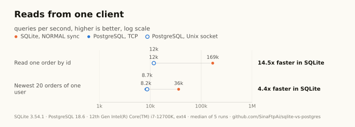
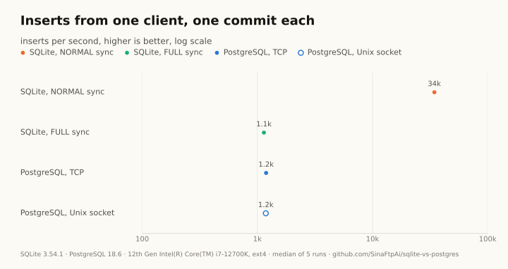
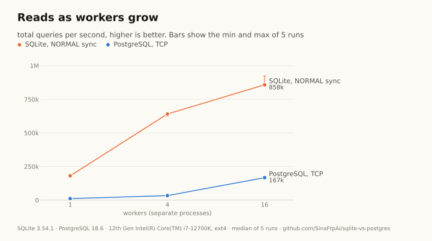
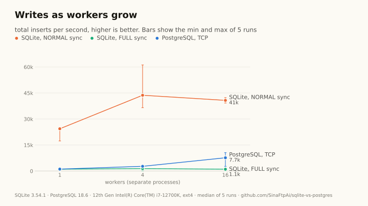
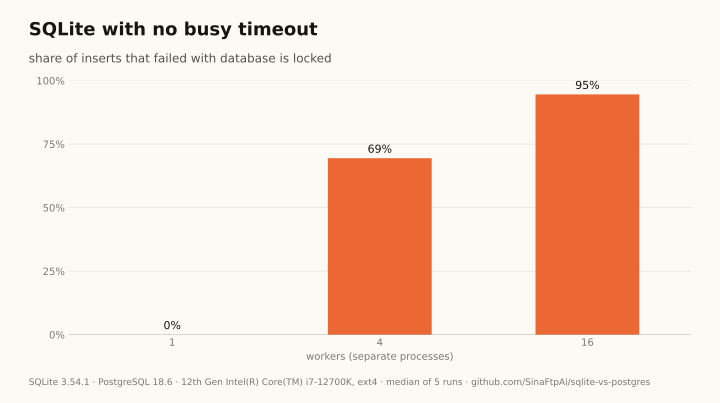
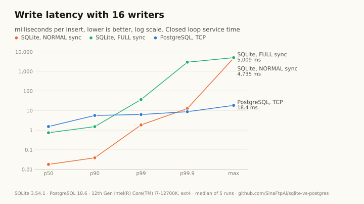
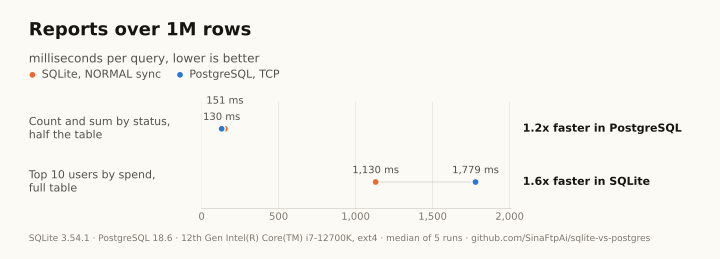

# SQLite vs PostgreSQL, measured

This repository measures SQLite and PostgreSQL on one machine. Both engines get the same data, the
same queries and the same disk, driven from the same Python code, so the numbers show what each
database does and where each one wins. It was made by Sina Fathpour (@sina_codes on Instagram) for a
teaching reel. The method, with every choice and its reason, is in [docs/METHOD.md](docs/METHOD.md).

## Results

<!-- results:start -->
The full run of 2026-11-05, on one machine: an Intel Core i7-12700K with 12 logical CPUs as seen by WSL2, 19.1 GB RAM and an ext4 disk, PostgreSQL 18.6 and SQLite 3.54.1, 1,000,000 orders, the median of 5 runs. Every table is in [results/2026-11-05-full/summary.md](results/2026-11-05-full/summary.md).

- **Reads from one client: SQLite is 14.5x faster.** Reading one order by its id, SQLite did 168,617 reads a second and PostgreSQL 11,619 (`point_read`). Over its Unix socket PostgreSQL did 11,732, the same, so the cost is the round trip to a separate server process, not TCP.
- **Writes from one client depend on durability.** With one commit per insert, SQLite with `synchronous=NORMAL` did 34,425 inserts a second. With `synchronous=FULL`, the same durability as PostgreSQL, it did 1,140, and PostgreSQL 1,191 (`single_insert`).
- **Many writers: SQLite makes them queue.** With 16 writer processes and a 5 second busy timeout, SQLite still wrote 40,756 inserts a second in total, but the slowest insert of a run waited 4.7 s and 4 inserts failed after the timeout. With no busy timeout, 94.6 percent of the inserts failed with `database is locked`. PostgreSQL did 7,662 a second with 0 errors, and its slowest insert took 18 ms (`concurrent_write`).
- **At the same durability, PostgreSQL wrote about 7x more with 16 writers:** 7,662 inserts a second against 1,081 for SQLite with `synchronous=FULL` (`concurrent_write`). These fsync bound runs vary a lot on this disk: PostgreSQL ran between 2,720 and 10,600 a second over the 5 runs, SQLite FULL between 202 and 1,308, and PostgreSQL wrote more in every run.
- **Reads scale on both.** With 16 reader processes SQLite did 858,069 reads a second and PostgreSQL 167,088, a 5.1x gap (`concurrent_read`). In the mixed workload (16 workers, 90 percent reads) SQLite did 168,543 operations a second and PostgreSQL 52,564, while SQLite's write p99 was 18.3 ms against 5.7 ms (`mixed`).
- **Reports and loading.** PostgreSQL was faster at the count by status (130 ms against 151 ms), SQLite at the top users by spend (1,130 ms against 1,779 ms) (`aggregate`). Loading the million rows took 1.9 s in SQLite and 10.9 s in PostgreSQL (`seed`).

<picture>
  <source media="(prefers-color-scheme: dark)" srcset="results/2026-11-05-full/charts/single-client-reads-dark.svg">
  
</picture>

<picture>
  <source media="(prefers-color-scheme: dark)" srcset="results/2026-11-05-full/charts/single-insert-dark.svg">
  
</picture>

<picture>
  <source media="(prefers-color-scheme: dark)" srcset="results/2026-11-05-full/charts/concurrent-reads-dark.svg">
  
</picture>

<picture>
  <source media="(prefers-color-scheme: dark)" srcset="results/2026-11-05-full/charts/concurrent-writes-dark.svg">
  
</picture>

<picture>
  <source media="(prefers-color-scheme: dark)" srcset="results/2026-11-05-full/charts/write-failures-dark.svg">
  
</picture>

<picture>
  <source media="(prefers-color-scheme: dark)" srcset="results/2026-11-05-full/charts/write-latency-16-dark.svg">
  
</picture>

<picture>
  <source media="(prefers-color-scheme: dark)" srcset="results/2026-11-05-full/charts/aggregates-dark.svg">
  
</picture>
<!-- results:end -->

## Run it yourself

You need Linux or macOS, Python 3.12, [uv](https://docs.astral.sh/uv/), and the tools that build
PostgreSQL: a C compiler, make, bison, flex and m4. On Debian or Ubuntu:

```bash
sudo apt install build-essential bison flex m4
```

On macOS:

```bash
brew install bison flex m4
```

Then get the code and its Python dependencies:

```bash
git clone https://github.com/SinaFtpAi/sqlite-vs-postgres.git
```

```bash
cd sqlite-vs-postgres
```

```bash
uv sync
```

Build the two engines from their official sources. `dbbench install` downloads PostgreSQL 18.6 and
SQLite 3.54.1, checks every file against its published hash, and builds them into `~/.cache/dbbench`.
It takes a few minutes, and a second run only checks what is there:

```bash
uv run dbbench install
```

A smoke run, about two minutes, to check that everything works on your machine:

```bash
uv run dbbench all --quick
```

The full run, about 35 minutes on the machine above, which writes the results in `results/`:

```bash
uv run dbbench all
```

Stop the benchmark's PostgreSQL cluster when you are done:

```bash
uv run dbbench stop
```

To use your own PostgreSQL, set `postgres.bin_dir` in `config/dbbench.yaml` to its `bin` folder.

## What it measures

- `footprint`: start time and idle memory of the PostgreSQL server, SQLite connect time, file sizes, and memory after the runs.
- `seed`: time to load the rows, rows per second, and the time to build the index and run ANALYZE.
- `single_insert`: one worker, one commit per insert.
- `point_read`: one worker, reads one order by its id.
- `user_read`: one worker, reads the newest orders of one user.
- `aggregate`: two aggregate queries, median and min, and a check that both engines return the same answers.
- `concurrent_read`: 1, 4 and 16 worker processes doing point reads for a fixed time.
- `concurrent_write`: 1, 4 and 16 worker processes inserting for a fixed time, with SQLite lock errors counted.
- `mixed`: 16 worker processes, 90 percent point reads and 10 percent inserts, with read and write latency kept apart.

## Charts

`uv run dbbench charts results/2026-11-05-full` draws the charts of a results folder, and `dbbench all` draws them at the end of every run. The SVG files go to `<results folder>/charts/`: one dark and one light file per chart (`<chart>-dark.svg` and `<chart>-light.svg`), plus `embed.md` with the picture blocks for this README. `charts.json` in the same folder holds the same numbers as the charts, for an interactive version later. Add `--png-preview DIR` to also save a PNG of every chart in a folder outside the repository.

## Fair by design

- Both stores sit on the same disk under the work folder. A RAM filesystem is refused, because it would hide the fsync cost.
- The same rows, generated from one seed, and the same queries. The two aggregates must return identical answers on every run.
- Durability is on for both: PostgreSQL has fsync on, and the SQLite variant `sqlite_wal_full` matches it.
- The same memory budget: SQLite's 64 MiB page cache equals PostgreSQL's `shared_buffers`.
- Each worker is a process with one persistent connection, and every write is its own transaction.
- The disk is settled before every measured run, and the engine order is shuffled for every repeat.
- Every scenario is repeated five times. The tables show the median, and `summary.json` has the min and max.

## Limits

- Latencies are closed loop service times. A stalled worker sends nothing, so the tails are understated. No open loop run is done.
- PostgreSQL 18.6 and SQLite 3.54.1 are built from source with default optimization, without readline, zlib, ICU, zstd and lz4 (none of them is used by these tests). PostgreSQL 19 was at release candidate 1 on 2026-11-05, so 18.6 is the newest final release.
- It is one machine and one disk. The numbers describe that hardware and its filesystem. On WSL2 the disk goes through a virtual layer, so fsync costs there may differ from a native Linux server or a Mac.
- Worker counts above the CPU count oversubscribe the machine. The 16-worker runs are only as wide as the CPUs allow.
- A quick run checks that the setup works. Its numbers are not results.

## Project layout

- `config/dbbench.yaml`: every number and name the benchmark uses.
- `src/dbbench/`: the package. `cli.py` is the command line. `scenarios.py` holds one class per scenario.
- `tests/`: unit tests and one SQLite only end-to-end test. They need no PostgreSQL.
- `docs/METHOD.md`: the method.
- `results/`: one folder per run, named by date and mode.
- `.github/workflows/ci.yml`: the same four checks as below, on every push and pull request.

## Development

From the repository folder:

```bash
uv run ruff check .
```

```bash
uv run ruff format --check .
```

```bash
uv run mypy src tests
```

```bash
uv run pytest
```

## License

MIT. See [LICENSE](LICENSE).
